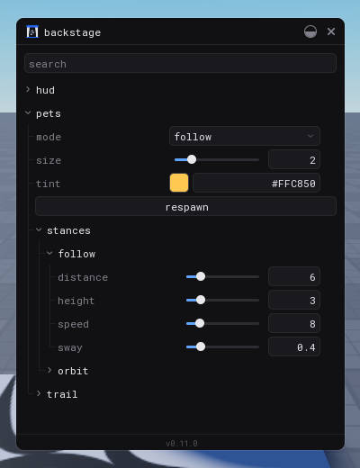
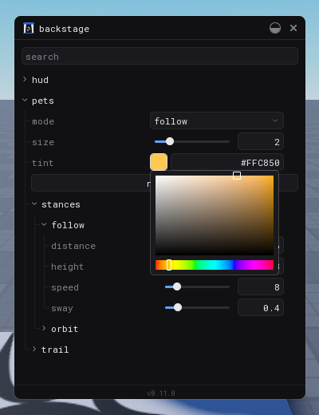
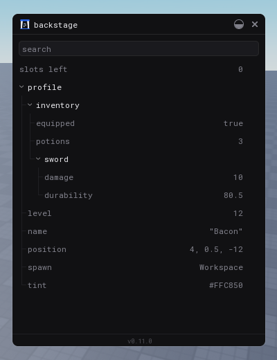

<div align="center">
  
  <br/><br/>
  <p>Live tuning panel for Roblox Studio: edit game values in real time.</p>
  <a href="https://github.com/omarcoaraujo/backstage/actions/workflows/check.yml"></a>
  <a href="https://github.com/omarcoaraujo/backstage/actions/workflows/release.yml"></a>
</div>

---

Stop editing a number, pressing play and waiting to see it. Declare a value once, drag a slider while the game runs, watch the game change on the spot, and keep what feels right.

<p align="center">
  
  
  
</p>

<p align="center">
  <video src="docs/backstage.mp4" width="40%" controls muted loop></video>
</p>

The read-only rows and expandable tables are built and shown in the UI stories, but `config` does not produce them yet. They arrive with store support.

---

## What it is

Backstage has two parts that work together:

1. **The library** lives in your game. You declare the values you want to tune, and a window opens in Studio with a control for each one.
2. **The tool** runs next to Studio. It writes every change you make in the window back into your script, so the next session starts from what you tuned.

That is the whole idea: tune by feel while you play, close Studio, and the numbers are already in your code. No export button, no JSON, no copying values.

At a glance:

- Sliders, toggles, text boxes, choices, a color picker, vector fields and buttons, picked from the kind of each default
- Limits and hints per value, a search bar, and a reset button on whatever you changed
- Reads that are plain (`config.speed`) and also tracked, so code that depends on a value reruns when you tune it
- Works across the network: a server value is tuned from the same window and sent to every player
- Negligible cost in production: outside Studio there is no UI, no remote and no listener, and a value is a plain table read

## Install

**The library**, in your `pesde.toml`:

```toml
[dependencies]
backstage = { name = "omarcoaraujo/backstage", version = "^0.14.2" }
```

**The tool**, with [Rokit](https://github.com/rojo-rbx/rokit):

```sh
rokit add omarcoaraujo/backstage
```

Then enable **Allow HTTP Requests** in the game settings of the place. The tool talks to Studio over a local connection, and Studio needs that setting to open it.

## Your first session

Five steps, about two minutes. Everything after this page goes deeper into each one.

**1. Declare a value.** Create a script that returns a config:

```lua
const backstage = require(path.to.backstage)

return backstage.config("pets", {
	speed = 8,
	tint = Color3.fromRGB(255, 200, 80),
}, {
	limits = { speed = { min = 0.5, max = 40 } },
})
```

**2. Start the window**, once on the client:

```lua
backstage.start()
```

**3. Run the tool** in your project folder and leave it open next to Studio:

```sh
backstage serve
```

**4. Press play** and open the window with `Ctrl + B`. You will see a `pets` group with a slider for `speed` and a color picker for `tint`.

**5. Drag the slider**, then look at your script: the `8` is now the number you stopped on. The game used the new value as you dragged it, and the file keeps it after Studio closes.

## The guide

Each part builds on the one before, so read it in order the first time.

### 1. Declaring values

A config is a table of defaults plus, optionally, a table of options. This one uses most of what exists:

```lua
const backstage = require(path.to.backstage)

return backstage.config("pets", {
	distance = 6,
	tint = Color3.fromRGB(255, 200, 80),
	mode = "follow",
	respawn = backstage.button(),
	trail = {
		enabled = true,
		length = 1.5,
	},
}, {
	limits = {
		distance = { min = 0, max = 30, step = 0.1 },
		mode = { "follow", "orbit" },
		trail = {
			length = { min = 0.1, max = 6, step = 0.1 },
		},
	},
})
```

How it is read:

- **The kind comes from the default:** number, boolean, string, `Color3` or `Vector3`. A `backstage.button()` becomes a button.
- **Limits** depend on the kind. A number takes `min`, `max` and `step`. A string takes a list of options, like `mode = { "follow", "orbit" }`, and becomes a choice. They are enforced on every edit, and numbers and vectors keep three decimals.
- **Nested tables become groups**, drawn with a line that shows the nesting. A dot in the config name nests it too: `backstage.config("pet.drops", ...)` and `backstage.config("pet.skins", ...)` both show up inside one `pet` group.
- **Every value has a path,** like `pets.trail.length`. You will see it in the window, in `on_change` and in the tool.

To explain a value or a button, add a `hints` table shaped like `limits`. The text shows as a tooltip when you hover the row:

```lua
{
	limits = { distance = { min = 0, max = 30, step = 0.1 } },
	hints = {
		distance = "How far behind the player the pet stays",
		respawn = "Brings the pet back to the player",
		trail = { length = "Seconds the trail takes to fade" },
	},
}
```

In the window, every changed value shows a reset arrow. A group shows one that resets everything inside it, and the title bar shows one that resets the whole window. A search bar filters the tree by name.

### 2. Reading values

Read the values as plain fields, always through the table `config` returns, so you see the latest edit:

```lua
const config = require(path.to.pets)

print(config.distance, config.trail.length)

config.respawn:connect(function()
	-- the button was pressed
end)
```

The game cannot write to the config. Only the window does, and writing from code raises an error.

### 3. Reading values that update themselves

A plain read gives you the current number. A read inside a Vide scope or a Charm effect also **tracks itself**, so it runs again when the window changes the value:

```lua
vide.create "Part" {
	Size = function()
		return Vector3.one * config.size
	end,
}

charm.effect(function()
	print(config.size)
end)
```

This is what lets you tune things a per-frame loop could never reach, like a HUD that rebuilds only when a value changes. [`example/ui/hud.luau`](example/ui/hud.luau) is a Vide card whose corner, scale, colors, title and rows all follow the window.

Vide works with the copy Backstage installs. If your game uses another copy of Vide, or uses Charm, hand them to `start` so the copy that tracks is the one your code uses:

```lua
backstage.start { vide = vide, charm = charm }
```

Charm is never required: without it a read inside a Charm effect is a plain read.

### 4. Reacting to a change

Some code caches a value instead of reading it every frame, like setting a part's size once. For that, hook a callback to a path. It works in any script, so you can use it right in your game code:

```lua
const function apply_size(size: number)
	pet.Size = Vector3.one * size
end

apply_size(config.size)
backstage.on_change(config.size, apply_size)
```

How it behaves:

- **The first argument is the config read itself,** with the path written out (`config.size`, `config.trail.length`). It finds the path from that read, so a typo is a type error. Anything else, such as a variable, a literal, an expression or a string, raises an error in Studio.
- **It fires on every change:** from the window, from a restore and from the other side of the network, with the new and the previous value.
- **It never fires for the value you start with,** so apply that one yourself, as above.
- **It returns a function** that disconnects it.

Outside Studio it does nothing, and since nothing changes there, the game ships with the value you applied first. Code written this way, setting a property when it changes and not on every frame, is cheaper than a loop anyway. [`example/client/pets.luau`](example/client/pets.luau) does it for the pet's size and color, and keeps reading the rest every frame.

To react to a whole group, or to every value of a config, pass the group instead. The callback gets the path that changed as a third argument, and it also gets it for a single value:

```lua
backstage.on_change(config.trail, function(value, previous, path)
	print(path, previous, value)
end)
```

A group has values of different kinds inside, so `value` and `previous` are typed as `backstage.value`, which is `number | boolean | string | Color3 | Vector3`. Narrow it with `typeof` or by the `path`, when you need the exact kind. A single value keeps its own type: `on_change(config.size, ...)` gives you a `number`.

To hear every change of every config, which is handy for a log or a debug overlay, use `backstage.on_any_change`. Its callback takes the same arguments as the group one: `(value, previous, path)`. Both return a function that disconnects them and do nothing outside Studio. [`example/ui/status.luau`](example/ui/status.luau) shows the two ways to react side by side: a Charm effect that rewrites a label from the values it reads, and `on_any_change` that shows the last change.

### 5. Opening the window

Call `start` on the client, and on the server if you want to tune server values too:

```lua
const backstage = require(path.to.backstage)

backstage.start()
```

`Ctrl + B` opens and closes the window. Pass `key` and `ctrl` to change it:

```lua
backstage.start { key = Enum.KeyCode.F4, ctrl = false }
```

The window is draggable and resizable, and it stays on screen when the screen gets smaller.

**Client and server.** A config declared in a shared module shows up once in the window. The server owns its value: an edit goes to the server, which validates it and tells every client. A config declared only on the server shows up in the window too, and its buttons run on the server. A value declared only on the client stays local to that client.

### 6. Keeping what you tuned

This is where Backstage pays off. Every change you make in the window is written back into the default of the matching `backstage.config` call, in place. The tool does it, so keep it running whenever you tune:

```sh
backstage serve --port 34891
```

The tool listens only on `127.0.0.1`, finds each config by name across the project, and refuses a name that is declared in two files or a value that is not a literal. The folder defaults to the current one, and `backstage serve path/to/project` picks another. `--port` is optional, and the same number goes to `backstage.start { port = 34891 }` if you change it.

Without the tool, everything you tune lives in the play session and is lost when it ends. Treat it as a required part of the workflow.

#### The file on disk is the source of truth

Backstage never saves its own copy of your numbers. The default written in the script on disk is the truth, and the window is only a way to change it. A value you tune and the same value you type into the script end up in the same place, so there is nothing to reconcile: no export, no stored overrides, and nothing to forget about.

The tool writes every change you make in the window into the file as you make it. The reset button is not about what is saved: it appears when a value differs from the one you started tuning from, and it takes you back to that value. Editing the script on disk is different. The number you type becomes the new starting point, so the window shows it as the original and there is nothing to go back to, and no reset button.

#### Editing the script by hand

The tool also watches your scripts. When you change a default by hand while the game is running, the new number is sent to the game: the value and its reset target change, and the window and every player follow. Edits the window made itself are not sent back.

The tool follows the literals it can read, the same ones it can write. A new value, or a config that was not running when you started the game, needs a restart.

The connection stays open during a play session so these changes can arrive. A web page cannot talk to the tool: it refuses any connection that comes from a browser, or that does not address `127.0.0.1`, `localhost` or `[::1]` on its own port.

#### Values built by a helper function

Repeated entries are often built by a small local function. The tool follows it, so you do not have to write every entry out as a table:

```lua
const function item(price: number, weight: number)
	return {
		stock = 10,
		price = price,
		weight = weight,
	}
end

return backstage.config("shop", {
	items = { item(10, 2), item(25, 5) },
})
```

- A field that is a parameter (`price`, `weight`) is saved into that argument of the matching call, so `shop.items.2.price` rewrites the `25`. The name in the window is the key (`price`), not the parameter's name
- A field that is a literal inside the function (`stock`) is saved into the function, so it changes for every call. Tuning it on one item changes all of them, and if you edit it on several in the same session the last edit wins
- The function must be a local function in the same file and return a table literal. Anything else, such as a function from another file or a computed value, is refused with the reason in the output

### 7. Using it in a storybook

`embed` puts the window inside any `GuiObject`, with no server, no `PlayerGui` and no play session. It is made for storybooks such as [UI Labs](https://github.com/PepeElToro41/ui-labs), which run in edit mode. It reads the values declared in the same script environment and returns a function that cleans everything up:

```lua
return function(target)
	require(path.to.pets)
	return backstage.embed(target)
end
```

The window opens already visible. The close button hides it and the same shortcut as `start` (`Ctrl + B`) shows it again. The options are `title`, `footer`, `port`, `key`, `ctrl`, `open`, `vide` and `charm`, where `open = false` starts it hidden. Edits are saved by the tool, as in a play session, and editing a script by hand also updates the window. [`stories/pet.story.luau`](stories/pet.story.luau) is a complete example: tuning the window moves a pet in the story.

A storybook reloads the story whenever the script changes, and that shapes how `embed` behaves:

- **One connection to the tool.** Embedding again reuses it, the cleanup closes it, and a connection left behind by a reload is closed by the next `embed` or by itself when idle.
- **The window keeps its place.** Its position and size are remembered by `title` between reloads, as long as the storybook stays open. Both are kept in `shared`, which UI Labs preserves across reloads.
- **Reset still goes to the original.** The tool rewrites the default in your script every time you edit, and the storybook then reloads the story with the new default. `embed` remembers the default each value had when the session began, so reset still returns to that original, as long as the default in the script is the one the tool saved. If you change a default by hand, that new default becomes the one reset returns to.
- **Edits are held until the story closes.** Sending them on every edit would reload the story on every edit, so `embed` holds them in memory and sends them to the tool when the story closes, which includes the unmount right before a reload. Edits that were never sent are lost if Studio closes before the story does.

## Going to production

`start` and `embed` do nothing outside Studio, and `config` returns a frozen copy of the defaults, so the values you declared are the ones the game ships with. There is no UI, no remote, no listener and no signal. It is not literally free: the library is still loaded, each `config` keeps one frozen copy of its defaults, and `config`, `button` and `on_change` check once per call whether Studio is running. Nothing runs after that, and reading a value is a plain table read. Use `backstage.disable()` to test that mode inside Studio, and `backstage.enable()` to force the Studio mode. Never ship a call to `enable`: on a live server it would let any player edit values and press buttons, because the server trusts every edit it receives while Backstage is on.

### Tuning on a live server

Pass the place ids where Backstage may run to `start` on the server, before any `config` is read:

```luau
backstage.start { places = { 1234567890 } }
```

The server alone decides, Studio included. The client waits for the game to load and follows the server: it turns on only if the server created the Backstage remote, so it needs no list and cannot turn Backstage on by itself. A `config` read on the server before `start` on a live place returns the frozen defaults and never updates.

On those places, and only there, the server and every player share the same window: an edit from one player reaches the server and all the others, and each player sees the others' cursors with their names, attached to the group and the value they are over. The control someone is using gets an outline in their color, and while they hold it nobody else can change that value: the row is blocked on the other windows, and the server refuses edits from anyone but whoever grabbed it first. Anywhere else outside Studio it stays off. Because a live server cannot reach the tool on your computer, nothing is saved to the scripts. Press the export button next to the theme button to see the changed values as lines such as `pets.distance = 8`, select them and copy them. To write them into the scripts, run the tool in your project folder, paste the text and press Enter on an empty line:

```sh
backstage apply
```

Or give it a file with the text:

```sh
backstage apply --file export.txt
```

It writes each value into the default of its config, refuses the ones it cannot place with the reason, and lists the lines it could not read. Never allow your production place: every player in it could edit values and press buttons.

## How it works

```
 your code                 Studio only
┌──────────────┐        ┌──────────────────────────┐
│ config.speed │◀───────│ registry (validated)     │◀── window (sliders, picker...)
└──────────────┘        └──────────────────────────┘
   plain read              │             │
   or tracked by           ▼             ▼
   Vide / Charm        server ⇄ clients  saving tool ──▶ your config script
```

Every value lives in a registry keyed by path, like `pets.trail.length`. The window writes to it, the registry validates against the limits, and your code reads the latest value through the table `config` returns. The tool listens to the registry and writes each change into your script.

## Example

A complete project is in [`example/`](example). It is a pet that follows the player, tuned from the window.

## Limitations

- Backstage is pre-1.0, so the API can still change between minor versions.
- Edits are lost when the play session ends unless the Backstage tool is running.
- Editing values of stores you already have (Vide, Charm) is not there yet.
- Fusion is not supported: its state does not track a plain read of the config, so a Fusion value does not follow the window.

## Contributing

See [CONTRIBUTING.md](CONTRIBUTING.md).

## License

MIT
